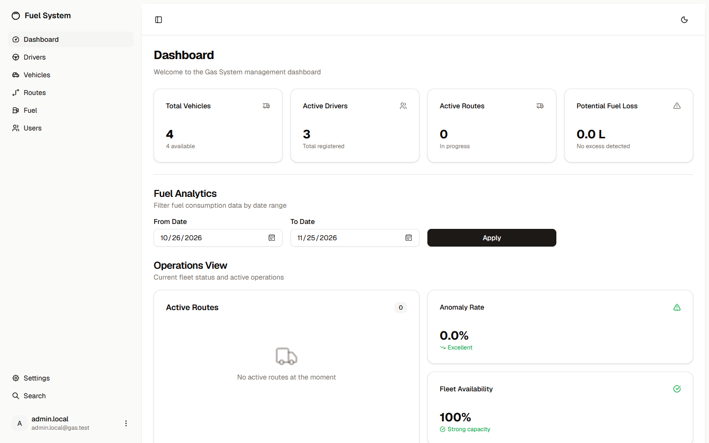
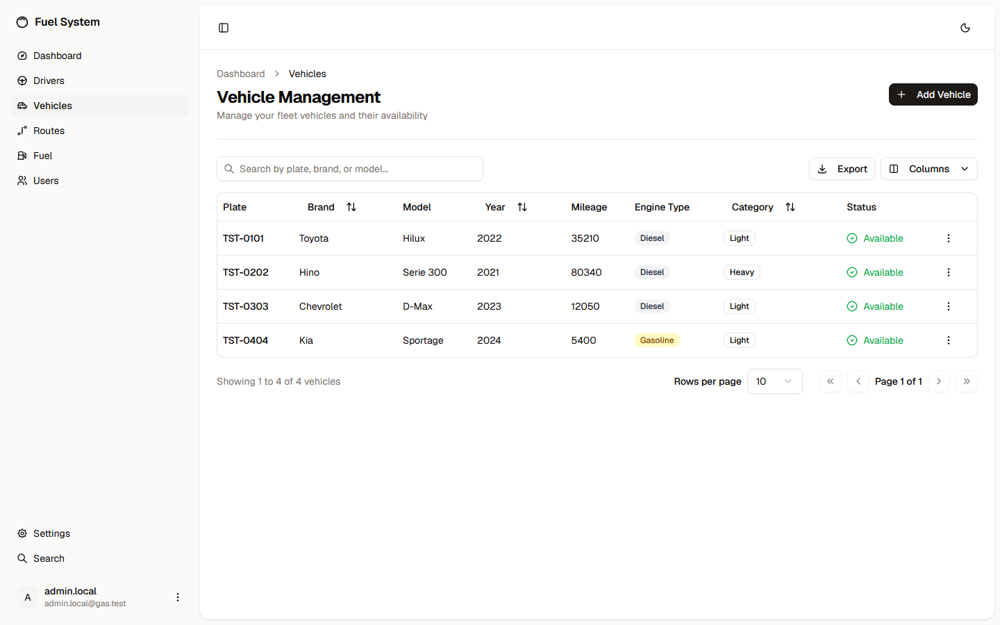

# Gas-System · Frontend

Panel web para gestionar una flota de vehículos: conductores, vehículos, rutas, combustible y usuarios.





Capturas con el sistema completo corriendo en local con Docker y datos de prueba.

Proyecto de Aplicaciones Distribuidas · Universidad Técnica de Ambato. El backend, con los microservicios y la API gateway, está en [Backend](https://github.com/Application-Distributed-Gasoline-System/Backend).

## Qué incluye

- **Tablero** con indicadores y gráficas.
- **Gestión** de conductores, vehículos, rutas, combustible y usuarios, con tablas paginadas.
- **Acceso por rol:** cada usuario solo ve las funciones que le corresponden.
- **Reportes en PDF** generados en el navegador.
- **Inicio de sesión** y recuperación de contraseña.

## Tecnología

Next.js 15, React 19, TypeScript, Tailwind CSS, componentes de Radix UI, TanStack Table, React Hook Form con Zod, Recharts y React PDF.

## Ejecutar

Requisitos: Node.js 20 o superior y el backend en marcha.

```bash
npm install
npm run dev
```

Abre `http://localhost:3001`.

Las llamadas a `/api` se reenvían a la API gateway (ver `next.config.ts`). Define su dirección, incluido `/api`, en un archivo `.env.local`:

```dotenv
BACKEND_URL=http://localhost:<puerto-de-la-gateway>/api
```

## Equipo

Frontend desarrollado por Sebastián Constante. El proyecto completo es de equipo; los integrantes aparecen como colaboradores de los dos repositorios.
